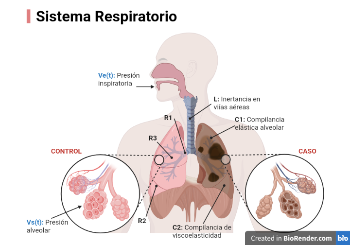
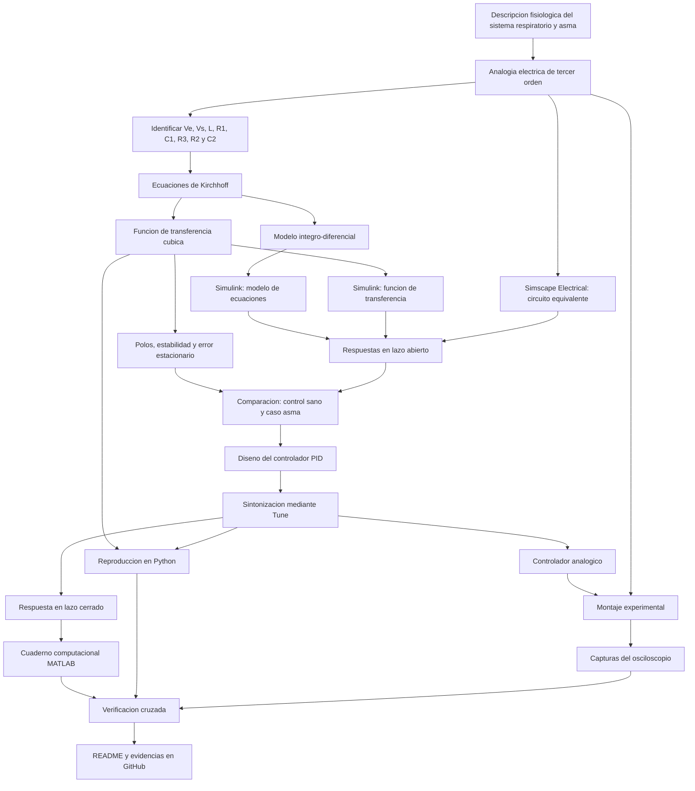

[](https://matlab.mathworks.com/open/github/v1?repo=emivilg/Proyecto-Final-Sistema-Respiratorio-Asma)
# Proyecto Final — Modelado y control de la mecánica ventilatoria (Asma)

Repositorio académico de la asignatura **Modelado de Sistemas Fisiológicos**, correspondiente al programa de **Ingeniería Biomédica** del Tecnológico Nacional de México / Instituto Tecnológico de Tijuana. Este proyecto integra la interpretación fisiológica, la construcción de circuitos eléctricos equivalentes, el modelado matemático, el análisis temporal y de estabilidad, el diseño de controladores PID, la simulación computacional y la verificación experimental en el Laboratorio de Electrónica.

El caso de estudio representa el **sistema respiratorio (mecánica ventilatoria)** mediante un modelo fenomenológico de tercer orden, compuesto por tres resistencias, dos capacitancias y una inductancia. Se busca reproducir y comparar la respuesta de una condición de referencia saludable (**control**) con una condición patológica asociada al **asma** (**caso**), tanto en lazo abierto como en lazo cerrado, mediante una estrategia de control orientada a reducir las diferencias entre ambas respuestas.

**Docente:** Dr. Paul Antonio Valle Trujillo  
**Correo:** paul.valle@tectijuana.edu.mx  
**Departamento:** Ingeniería Eléctrica y Electrónica  
**Institución:** Tecnológico Nacional de México / Instituto Tecnológico de Tijuana  
**Asignatura:** Modelado de Sistemas Fisiológicos  
**Programa:** Ingeniería Biomédica  
**Estudiantes:** Sara Gutiérrez Hernández · 23212734 · l23212734@tectijuana.edu.mx
                 Emiliano Villalobos Garcia · 232122434 · l23212243@tectijuana.edu.mx

**Repositorio de la asignatura:** https://github.com/DrPaulValle/MSF-IBF1020  
**Sede:** Blvd. Alberto Limón Padilla s/n, Tijuana, C. P. 22454, B. C., México.

---

<a id="contenido"></a>
## Contenido

1. [Resumen](#resumen)
2. [Competencia y objetivos](#objetivos)
3. [Relación con el temario](#temario)
4. [Modelo físico y analogía eléctrica](#analogia)
5. [Formulación matemática](#modelo)
6. [Análisis temporal y de estabilidad](#analisis)
7. [Señales de entrada y condiciones de simulación](#senales)
8. [Implementación en MATLAB, Simulink y Simscape](#matlab)
9. [Control en lazo cerrado y sintonización PID](#pid)
10. [Reproducción en Python](#python)
12. [Resultados y verificación cruzada](#resultados)
13. [Flujo de trabajo](#flujo)
14. [Actividades del estudiante](#actividades)
15. [Estructura del repositorio](#estructura)
16. [Requisitos](#requisitos)
17. [Reproducibilidad y entregables](#reproducibilidad)
18. [Referencias](#referencias)

---

<a id="resumen"></a>
## Resumen

El proyecto tiene como propósito **desarrollar un procedimiento de modelado, análisis, simulación y control** de la mecánica ventilatoria del sistema respiratorio mediante una analogía eléctrica de tercer orden. El modelo representa de manera simplificada los procesos de flujo aéreo en vías de conducción, inertancia gaseosa, distensibilidad (compliancia) alveolar y comportamiento viscoelástico del parénquima pulmonar utilizando tres resistencias $R_1$, $R_2$ y $R_3$, dos capacitancias $C_1$ y $C_2$, y una inductancia $L$. A partir de las leyes de Kirchhoff se formulan las ecuaciones integro-diferenciales del circuito, se obtiene su función de transferencia mediante la transformada de Laplace y se analizan los polos, la estabilidad y el error en estado estacionario.

Se comparan dos condiciones: un **individuo sano de referencia (control)** y un **caso simulado de obstrucción bronquial por asma**, representado mediante la modificación simultánea de la resistencia de vías aéreas centrales $R_1$, la resistencia paralela $R_3$ y la compliancia dinámica secundaria $C_2$. Se aplica un tren periódico de pulsos rectangulares (y evaluación analítica ante escalón) para evaluar las respuestas en lazo abierto y posteriormente se incorpora un **controlador PID con retroalimentación negativa**, sintonizado mediante la herramienta Tune de Simulink, con la finalidad de aproximar la respuesta del caso a la del control. Los modelos se implementan en MATLAB/Simulink y Simscape Electrical, mientras que sus resultados se reproducen mediante Python para realizar una verificación computacional cruzada.

El proyecto integra la **implementación experimental en el Laboratorio de Electrónica**, mediante la construcción de los circuitos eléctricos equivalentes correspondientes al control y al caso, así como del controlador analógico. Las respuestas en lazo abierto y en lazo cerrado se registran mediante osciloscopio y se contrastan con las simulaciones desarrolladas en MATLAB/Simulink, Simscape Electrical y Python, considerando las características dinámicas de los componentes y las diferencias entre los resultados computacionales y experimentales.

Este trabajo corresponde a un ejercicio de **modelado y verificación computacional y experimental**. Su finalidad es interpretar la relación entre los elementos eléctricos y los procesos fisiológicos de la ventilación pulmonar, comparar el comportamiento dinámico de dos condiciones del sistema respiratorio y evaluar una estrategia de control clásico. La analogía es de carácter fenomenológico y académico; los valores de sus componentes fueron seleccionados heurísticamente y no representan directamente magnitudes fisiológicas medidas experimentalmente.

**Palabras clave:** mecánica ventilatoria; asma; modelo compartimental; circuito RLC de tercer orden; compliancia pulmonar; controlador PID; MATLAB; Simulink; Simscape Electrical; Python; simulación *in silico*; instrumentación electrónica.

[Volver al contenido](#contenido)

---

<a id="objetivos"></a>
## Competencia y objetivos

### Competencia a desarrollar

Modeliza sistemas fisiológicos mediante analogías eléctricas, ecuaciones diferenciales y funciones de transferencia para analizar su comportamiento dinámico y diseña estrategias de control mediante técnicas de control clásico. En particular, durante este proyecto se interpreta una descripción simplificada de los procesos de flujo de aire a través de las vías aéreas, inertancia gaseosa, distensibilidad alveolar y viscoelasticidad tisular para construir un circuito eléctrico equivalente de tercer orden. Posteriormente, se compara una condición de referencia saludable (control) con una condición patológica de asma (caso), se diseña un controlador PID y se contrastan los resultados obtenidos mediante modelado analítico, simulación computacional y experimentación en el Laboratorio de Electrónica.

### Objetivo general

Modelar y analizar el comportamiento dinámico de la mecánica ventilatoria en condiciones normales y asmáticas mediante una representación eléctrica de tercer orden, formulando sus ecuaciones y funciones de transferencia para comparar las condiciones control y caso, diseñar una estrategia de control con retroalimentación negativa y verificar las respuestas obtenidas mediante MATLAB/Simulink, Simscape Electrical, Python y experimentación en el Laboratorio de Electrónica.

### Objetivos específicos

- Interpretar los procesos fisiológicos de flujo aéreo bronquial, inertancia, distensibilidad alveolar y relajación viscoelástica para establecer su correspondencia con los elementos de un circuito eléctrico equivalente.
- Construir los circuitos correspondientes a las condiciones control y caso, identificando la entrada, la salida, las corrientes de rama y los elementos $L$, $R_1$, $C_1$, $R_3$, $R_2$ y $C_2$.
- Formular las ecuaciones integro-diferenciales del sistema mediante las leyes de Kirchhoff y obtener su función de transferencia aplicando la transformada de Laplace.
- Determinar las funciones de transferencia de ambas condiciones, considerando la modificación simultánea de $R_1$, $R_3$ y $C_2$.
- Calcular el error en estado estacionario y los polos de tercer orden de los modelos para analizar su estabilidad y comportamiento sobreamortiguado.
- Elaborar un bosquejo cualitativo de las respuestas temporales a partir del análisis matemático y compararlo con los resultados de las simulaciones.
- Implementar las ecuaciones del sistema, las funciones de transferencia y los circuitos eléctricos equivalentes mediante MATLAB/Simulink y Simscape Electrical.
- Analizar las respuestas en lazo abierto del control y del caso ante un tren periódico de pulsos rectangulares.
- Diseñar un sistema de retroalimentación negativa utilizando la respuesta del control como referencia para el caso y sintonizar un controlador PID mediante la herramienta Tune de Simulink.
- Desarrollar un cuaderno computacional de MATLAB para ejecutar las simulaciones, representar gráficamente las respuestas y almacenar los resultados en formato PDF.
- Reproducir las funciones de transferencia y las respuestas del sistema mediante Python para verificar la consistencia de los resultados computacionales.
- Calcular los componentes del controlador analógico a partir de las ganancias proporcional, integral y derivativa, y construir su representación mediante Simscape Electrical.
- Implementar experimentalmente los circuitos correspondientes al control y al caso, así como el sistema con controlador, utilizando los componentes eléctricos y equipos del Laboratorio de Electrónica.
- Registrar mediante osciloscopio las respuestas en lazo abierto y en lazo cerrado, y comparar los resultados experimentales con las simulaciones computacionales.
- Elaborar un diagrama biológico que relacione las estructuras del sistema respiratorio y la fisiopatología del asma con los componentes y variables del circuito eléctrico equivalente.
- Documentar el análisis matemático, los modelos computacionales, las ganancias del controlador, las simulaciones y las evidencias experimentales en un repositorio de GitHub.

[Volver al contenido](#contenido)

---

<a id="temario"></a>
## Relación con el temario

El proyecto integra contenidos correspondientes a tres unidades de la asignatura **Modelado de Sistemas Fisiológicos (IBF-1020)**:

| Unidad | Área | Contenidos aplicados |
|---|---|---|
| I | Sistemas de control retroalimentados | Diagramas de bloques, respuesta temporal, error en estado estacionario y análisis de estabilidad |
| II | Modelado matemático | Analogía neumática-eléctrica del sistema respiratorio, leyes de Kirchhoff, ecuaciones integro-diferenciales y función de transferencia de tercer orden |
| III | Controladores | Diseño, sintonización e implementación de un controlador PID |

El enfoque combina **Ingeniería de Control, Electrónica Analógica, Ciencias de la Computación y Fisiología Respiratoria**, mediante la representación de procesos ventilatorios y su análisis matemático, computacional y experimental.

[Volver al contenido](#contenido)

---

<a id="analogia"></a>
## Modelo físico y analogía eléctrica

El sistema respiratorio se representa mediante un circuito eléctrico RLC de tercer orden que aproxima el flujo de aire en las vías de conducción, la inercia de la columna gaseosa, la distensibilidad estática alveolar y la viscoelasticidad del parénquima pulmonar. La entrada $V_e(t)$ representa la presión motriz inspiratoria ($P_{mus}$), mientras que la salida $V_s(t)$ corresponde a la presión alveolar efectiva ($P_{alv}$) en el compartimento pulmonar principal.

| Variable o componente | Representación eléctrica | Interpretación fisiológica |
|---|---|---|
| $V_e(t)$ | Voltaje de entrada | Presión motriz respiratoria ($P_{mus}$) generada por diafragma e intercostales |
| $i_e(t)$ | Corriente de entrada | Flujo volumétrico total de aire ($\dot{V}$) que ingresa por las vías centrales |
| $L$ | Inductancia | Inertancia gaseosa en la tráquea y bronquios principales |
| $R_1$ | Resistencia | Resistencia viscosa al flujo en las vías aéreas centrales ($R_{aw,\mathrm{central}}$) |
| $C_1$ | Capacitancia | Compliancia estática principal del parénquima alveolar (compartimento rápido) |
| $R_3$ | Resistencia | Aproximación fenomenológica de disipación / ajuste de ganancia paralela a tierra |
| $R_2$ | Resistencia | Resistencia viscoelástica tisular o resistencia de vías aéreas periféricas |
| $C_2$ | Capacitancia | Compliancia dinámica del compartimento alveolar secundario / viscoelasticidad |
| $V_s(t)$ | Voltaje de salida | Presión alveolar efectiva ($P_{alv}$) en el nodo principal |

El circuito considera una fuente $V_e(t)$ conectada en serie con $L$ y $R_1$. En el nodo de salida $V_s(t)$ parten dos ramas hacia tierra: una formada por $C_1$ en paralelo con $R_3$, y otra formada por $R_2$ en serie con $C_2$.

### Parámetros para la emulación eléctrica

| Parámetro | Control (sano) | Caso (asma) |
|---|---:|---:|
| $L$ | $10\ \mu\mathrm{H}$ | $10\ \mu\mathrm{H}$ |
| $R_1$ | $10\ \Omega$ | $30\ \Omega$ |
| $C_1$ | $1\ \mu\mathrm{F}$ | $1\ \mu\mathrm{F}$ |
| $R_3$ | $1\ \mathrm{k}\Omega$ | $100\ \Omega$ |
| $R_2$ | $100\ \Omega$ | $100\ \Omega$ |
| $C_2$ | $1\ \mu\mathrm{F}$ | $0.1\ \mu\mathrm{F}$ |

La modificación simultánea de $R_1$, $R_3$ y $C_2$ permite representar el incremento de la resistencia bronquial por broncoconstricción e inflamación, así como la reducción de la distensibilidad dinámica efectiva por atrapamiento aéreo. Para el diseño del controlador se utiliza la respuesta del control como referencia y se define el error como:

$$
e(t)=V_{s,\mathrm{control}}(t)-V_{s,\mathrm{caso}}(t).
$$

La analogía es de carácter fenomenológico y sus parámetros eléctricos fueron seleccionados heurísticamente para obtener respuestas dinámicas diferenciables, por lo que no representan directamente magnitudes fisiológicas medidas experimentalmente.

### Representación biológica del sistema

El diagrama elaborado mediante BioRender relaciona las vías aéreas centrales, los alvéolos, la broncoconstricción asmática y la distensibilidad pulmonar con cada componente del circuito eléctrico equivalente.



**Figura 1.** Representación anatómica y fisiopatológica del sistema respiratorio (control sano vs. caso asma) y su correspondencia con el circuito eléctrico de tercer orden. Elaboración mediante BioRender.

[Volver al contenido](#contenido)

---

<a id="modelo"></a>
## Formulación matemática

### 1. Ecuaciones integro-diferenciales

Aplicando las leyes de Kirchhoff al circuito eléctrico equivalente del sistema respiratorio, se establece la relación en el lazo de entrada y en el nodo $V_s(t)$ mediante las corrientes $i_e(t)$, $i_{C1}(t)$, $i_{R3}(t)$ e $i_2(t)$:

```math
V_e(t) = L\frac{di_e(t)}{dt} + R_1 i_e(t) + V_s(t).
```

En el nodo $V_s(t)$, la ley de corrientes de Kirchhoff establece:

```math
i_e(t) = i_{C1}(t) + i_{R3}(t) + i_2(t) = C_1\frac{dV_s(t)}{dt} + \frac{V_s(t)}{R_3} + \frac{V_s(t) - v_{C2}(t)}{R_2}.
```

Para la rama serie $R_2 - C_2$, la corriente $i_2(t)$ y el voltaje en el capacitor secundario $v_{C2}(t)$ cumplen:

```math
i_2(t) = C_2\frac{dv_{C2}(t)}{dt} = \frac{V_s(t) - v_{C2}(t)}{R_2}, \qquad v_{C2}(t) = \frac{1}{C_2}\int_0^t i_2(\tau)\,d\tau + v_{C2}(0).
```

Por lo tanto, el modelo en forma integro-diferencial se expresa mediante:

```math
\boxed{
V_e(t) = L\frac{di_e(t)}{dt} + R_1 i_e(t) + \frac{1}{C_1}\int_0^t \left[i_e(\tau) - \frac{V_s(\tau)}{R_3} - i_2(\tau)\right]d\tau + V_s(0)
}
```

```math
\boxed{
\frac{1}{C_1}\int_0^t i_{C1}(\tau)\,d\tau + V_s(0) = R_2 i_2(t) + \frac{1}{C_2}\int_0^t i_2(\tau)\,d\tau + v_{C2}(0)
}
```

### 2. Función de transferencia

Aplicando la transformada de Laplace con condiciones iniciales nulas ($i_e(0^-) = 0$, $V_s(0^-) = 0$, $v_{C2}(0^-) = 0$):

```math
V_e(s) = (sL + R_1)I_e(s) + V_s(s).
```

Las corrientes de rama en el dominio de Laplace son:

```math
I_{C1}(s) = sC_1 V_s(s), \qquad I_{R3}(s) = \frac{1}{R_3}V_s(s), \qquad I_2(s) = \frac{sC_2}{1 + sR_2 C_2}V_s(s).
```

Sustituyendo $I_e(s) = I_{C1}(s) + I_{R3}(s) + I_2(s)$ en la ecuación del lazo de entrada y despejando $H(s) = \frac{V_s(s)}{V_e(s)}$:

```math
\boxed{
H(s) = \frac{V_s(s)}{V_e(s)} = \frac{1 + sR_2 C_2}{a s^3 + b s^2 + c s + d}
}
```

donde los coeficientes del polinomio característico están definidos por:

```math
a = L C_1 R_2 C_2, \qquad b = L(C_1 + C_2) + R_2 C_2\left(\frac{L}{R_3} + R_1 C_1\right),
```

```math
c = \frac{L}{R_3} + R_1(C_1 + C_2) + R_2 C_2\left(1 + \frac{R_1}{R_3}\right), \qquad d = 1 + \frac{R_1}{R_3}.
```

El denominador es de tercer grado debido a la presencia de tres elementos independientes de almacenamiento de energía: la inductancia $L$ y las capacitancias $C_1$ y $C_2$.

### 3. Funciones de transferencia del control y del caso

**Condición de referencia (control sano)**

Considerando los parámetros $L = 10^{-5}\ \mathrm{H}$, $R_1 = 10\ \Omega$, $C_1 = 10^{-6}\ \mathrm{F}$, $R_3 = 1000\ \Omega$, $R_2 = 100\ \Omega$ y $C_2 = 10^{-6}\ \mathrm{F}$:

```math
H_{\mathrm{control}}(s) =
\frac{1 + 10^{-4}s}
{10^{-15}s^3 + 1.021\times 10^{-9}s^2 + 1.2101\times 10^{-4}s + 1.01}.
```

**Condición alterada (caso asma)**

Considerando $L = 10^{-5}\ \mathrm{H}$, $R_1 = 30\ \Omega$, $C_1 = 10^{-6}\ \mathrm{F}$, $R_3 = 100\ \Omega$, $R_2 = 100\ \Omega$ y $C_2 = 10^{-7}\ \mathrm{F}$:

```math
H_{\mathrm{caso}}(s) =
\frac{1 + 10^{-5}s}
{10^{-16}s^3 + 3.12\times 10^{-10}s^2 + 4.61\times 10^{-5}s + 1.30}.
```

La modificación simultánea de $R_1$, $R_3$ y $C_2$ produce diferencias en la ganancia estática, la ubicación de los polos y el cero finito, modificando la amplitud y la dinámica transitoria de ambos modelos.

### 4. Representación mediante ecuaciones diferenciales de tercer orden

Definiendo las variables de estado $x_1(t) = i_e(t)$, $x_2(t) = V_s(t)$ y $x_3(t) = v_{C2}(t)$, el sistema de tercer orden se expresa mediante tres ecuaciones diferenciales ordinarias acopladas:

```math
\boxed{
\frac{dx_1(t)}{dt} = \frac{V_e(t) - R_1 x_1(t) - x_2(t)}{L}
}
```

```math
\boxed{
\frac{dx_2(t)}{dt} = \frac{1}{C_1}\left[x_1(t) - \left(\frac{1}{R_3} + \frac{1}{R_2}\right)x_2(t) + \frac{x_3(t)}{R_2}\right]
}
```

```math
\boxed{
\frac{dx_3(t)}{dt} = \frac{x_2(t) - x_3(t)}{R_2 C_2}
}
```

La variable de salida corresponde al voltaje del nodo principal:

```math
V_s(t) = x_2(t).
```

Esta representación permite implementar el modelo mediante bloques de integración en Simulink y verificar su equivalencia con la función de transferencia y el circuito eléctrico construido en Simscape Electrical.

[Volver al contenido](#contenido)

---

<a id="analisis"></a>
## Análisis temporal y de estabilidad

### 1. Error en estado estacionario

Para determinar el error en estado estacionario de ambas condiciones se considera la función de transferencia del sistema respiratorio:

```math
H(s) = \frac{V_s(s)}{V_e(s)} = \frac{1 + sR_2 C_2}{a s^3 + b s^2 + c s + d}.
```

Ante una entrada escalón unitario:

```math
V_e(s) = \frac{1}{s}, \qquad V_s(s) = H(s)\frac{1}{s}.
```

Aplicando el teorema del valor final, considerando que el sistema es estable:

```math
e_{ss} = \lim_{s\to 0} s V_e(s)[1 - H(s)].
```

Sustituyendo $H(0) = \frac{1}{1 + R_1 / R_3} = \frac{R_3}{R_1 + R_3}$ y simplificando:

```math
\boxed{
e_{ss} = 1 - \frac{R_3}{R_1 + R_3} = \frac{R_1}{R_1 + R_3}
}
```

**Condición de referencia (control)**

Para $R_1 = 10\ \Omega$ y $R_3 = 1000\ \Omega$:

```math
e_{ss,\mathrm{control}} = \frac{10}{10 + 1000} = \frac{10}{1010}.
```

Por lo tanto:

```math
\boxed{e_{ss,\mathrm{control}} = 0.009901\ \mathrm{V}}
```

**Condición alterada (caso asma)**

Para $R_1 = 30\ \Omega$ y $R_3 = 100\ \Omega$:

```math
e_{ss,\mathrm{caso}} = \frac{30}{30 + 100} = \frac{30}{130}.
```

Por lo tanto:

```math
\boxed{e_{ss,\mathrm{caso}} = 0.230769\ \mathrm{V}}
```

La diferencia entre las respuestas en meseta de ambas condiciones es:

```math
\boxed{
\Delta V_s(\infty) = 0.990099 - 0.769231 = 0.220868\ \mathrm{V}
}
```

El control presenta un error en estado estacionario considerablemente menor que el caso. El incremento de $R_1$ y la disminución de $R_3$ reducen la ganancia estática en el caso asmático y producen una separación clara entre ambas salidas.

### 2. Polos y estabilidad

La estabilidad se determina mediante las raíces del denominador de la función de transferencia igualado a cero:

```math
a s^3 + b s^2 + c s + d = 0.
```

**Condición de referencia (control)**

Sustituyendo los coeficientes calculados ($a = 10^{-15}$, $b = 1.021\times 10^{-9}$, $c = 1.2101\times 10^{-4}$, $d = 1.01$):

```math
10^{-15}s^3 + 1.021\times 10^{-9}s^2 + 1.2101\times 10^{-4}s + 1.01 = 0.
```

Los polos obtenidos son:

```math
\boxed{
\lambda_1 = -9028.02, \qquad
\lambda_2 = -126317.81, \qquad \lambda_3 = -885654.17
}
```

**Condición alterada (caso asma)**

Para los coeficientes del caso ($a = 10^{-16}$, $b = 3.12\times 10^{-10}$, $c = 4.61\times 10^{-5}$, $d = 1.30$):

```math
10^{-16}s^3 + 3.12\times 10^{-10}s^2 + 4.61\times 10^{-5}s + 1.30 = 0.
```

Los polos correspondientes son:

```math
\boxed{
\lambda_1 = -37704.97, \qquad
\lambda_2 = -116242.78, \qquad \lambda_3 = -2966052.25
}
```

Ambas condiciones presentan tres polos reales y negativos, por lo que sus modelos son **estables y sobreamortiguados**. El polo dominante del caso está más a la izquierda que el del control, aunque no todos los polos se desplazan en la misma dirección.

### 3. Análisis de la respuesta temporal

| Característica | Control (sano) | Caso (asma) |
|---|---:|---:|
| Ganancia estática $H(0)$ | 0.990099 | 0.769231 |
| Error estacionario $e_{ss}$ | 0.009901 | 0.230769 |
| Polo real ($\lambda_1$) | -9028.02 | -37704.97 |
| Polos reales ($\lambda_{2,3}$) | -126317.81, -885654.17 | -116242.78, -2966052.25 |
| Cero finito ($s_z = -1/R_2 C_2$) | -10000 | -100000 |
| Estabilidad | Estable | Estable |
| Comportamiento | Sobreamortiguado | Sobreamortiguado |

Durante cada pulso inspiratorio de amplitud $1\ \mathrm{V}$, la respuesta del control alcanza rápidamente un valor próximo a $0.99\ \mathrm{V}$, mientras que la respuesta del caso alcanza aproximadamente $0.77\ \mathrm{V}$.

La modificación simultánea de $R_1$, $R_3$ y $C_2$ altera tanto el amortiguamiento transitorio como la ganancia estática del sistema, justificando el diseño de una estrategia de control PID para compensar la pérdida de amplitud en el paciente asmático.

### 4. Predicción previa

A partir de la localización de los polos en el semiplano izquierdo y de los valores estacionarios, se espera que ambas condiciones presenten respuestas estables con transitorios muy rápidos (del orden de microsegundos) seguidos de una meseta bien definida. El control mostrará una amplitud casi idéntica a la señal de entrada, mientras que el caso exhibirá una atenuación evidente durante la fase activa del pulso.

Las respuestas obtenidas mediante MATLAB/Simulink y Python permiten contrastar estas predicciones con el comportamiento de los modelos y evaluar posteriormente el efecto del controlador PID.

[Volver al contenido](#contenido)

---

<a id="senales"></a>
## Señales de entrada y condiciones de simulación

El proyecto utiliza un **tren periódico de pulsos rectangulares** para analizar las respuestas dinámicas del sistema respiratorio, complementado con el análisis teórico de escalón unitario. La señal representa ciclos sucesivos de contracción inspiratoria activa ($V_e(t) = 1\ \mathrm{V}$) seguidos de relajación espiratoria pasiva ($V_e(t) = 0\ \mathrm{V}$).

La entrada se define mediante:

```math
V_e(t) = \sum_{k=0}^{N} A \left[ u(t - kT) - u(t - kT - \tau_p) \right],
```

con amplitud $A = 1\ \mathrm{V}$ (valor normalizado académico), período $T = 10\ \mathrm{s}$ y duración de pulso $\tau_p = 0.5\ \mathrm{s}$ (ciclo de trabajo $D = 5\%$).

| Señal | Definición | Propósito |
|---|---|---|
| Tren de pulsos rectangulares | Amplitud $1\ \mathrm{V}$, período $10\ \mathrm{s}$, ancho $0.5\ \mathrm{s}$ | Analizar la respuesta inspiratoria, nivel de meseta y descarga espiratoria del control y del caso |

### Condiciones de simulación

En MATLAB/Simulink se establece un intervalo de $0 \leq t \leq 20\ \mathrm{s}$ (2 ciclos respiratorios simulados), utilizando el solver `ode15s` y un paso máximo de integración de $10^{-3}\ \mathrm{s}$ (o adaptado para capturar los flancos rápidos).

La configuración se realiza mediante:

```matlab
clc; clear; close all; warning('off','all')
open_system('sistema_asma')
parameters.StopTime = '20';
parameters.Solver = 'ode15s';
parameters.MaxStep = '1e-3';
x = sim('sistema_asma',parameters);
```

En Python se utiliza un intervalo de $0 \leq t \leq 20\ \mathrm{s}$, con una discretización fina y condiciones iniciales nulas:

```python
x0,t0,tend,dt,w,h = 0,0,20,1E-4,10,5
N = round((tend-t0)/dt)+1
t = np.linspace(t0,tend,N)
u = ((t % 10) < 0.5).astype(float)
```

La simulación en una ventana de $20\ \mathrm{s}$ permite observar dos ciclos completos, visualizando claramente la separación de amplitud entre el control y el caso durante cada pulso inspiratorio.

Las señales analizadas corresponden a:

1. **Entrada:** $V_e(t)$, presión motriz aplicada al sistema.
2. **Control:** $V_{s,\mathrm{control}}(t)$, presión alveolar de referencia (individuo sano).
3. **Caso:** $V_{s,\mathrm{caso}}(t)$, presión alveolar de la condición alterada (asma).
4. **Sistema controlado:** $V_{s,\mathrm{PID}}(t)$, respuesta del caso con controlador PID.

Las cuatro señales se representan gráficamente para comparar las diferencias temporales entre ambas condiciones y evaluar el seguimiento obtenido mediante el sistema de control.

[Volver al contenido](#contenido)

---

<a id="matlab"></a>
## Implementación en MATLAB, Simulink y Simscape

El sistema respiratorio se implementa mediante tres representaciones equivalentes: el modelo de ecuaciones integro-diferenciales / variables de estado, la función de transferencia y el circuito eléctrico construido mediante Simscape Electrical.

| Implementación | Descripción | Aspecto por verificar |
|---|---|---|
| Ecuaciones integro-diferenciales, Simulink | Bloques de integración, suma y ganancias correspondientes a las leyes de Kirchhoff | Consistencia con las ecuaciones del circuito |
| Función de transferencia, Simulink | Representación de $H(s)$ de tercer orden para control y caso | Concordancia de las respuestas temporales |
| Circuito equivalente, Simscape Electrical | Componentes $L$, $R_1$, $C_1$, $R_3$, $R_2$ y $C_2$ | Correspondencia con el modelo matemático |

### 1. Implementación del modelo matemático

La representación del sistema se obtiene a partir de las ecuaciones diferenciales acopladas:

```math
L\frac{di_e(t)}{dt} = V_e(t) - R_1 i_e(t) - V_s(t),
```

```math
C_1\frac{dV_s(t)}{dt} = i_e(t) - \frac{V_s(t)}{R_3} - i_2(t), \qquad R_2 C_2\frac{dv_{C2}(t)}{dt} = V_s(t) - v_{C2}(t).
```

Estas ecuaciones se implementan mediante bloques de Simulink, permitiendo reproducir las respuestas dinámicas para ambas condiciones.

### 2. Implementación de la función de transferencia

Las funciones utilizadas para la simulación son:

**Control (sano):**

```math
H_{\mathrm{control}}(s) =
\frac{1 + 10^{-4}s}
{10^{-15}s^3 + 1.021\times 10^{-9}s^2 + 1.2101\times 10^{-4}s + 1.01}.
```

**Caso (asma):**

```math
H_{\mathrm{caso}}(s) =
\frac{1 + 10^{-5}s}
{10^{-16}s^3 + 3.12\times 10^{-10}s^2 + 4.61\times 10^{-5}s + 1.30}.
```

Ambas representaciones permiten analizar las diferencias producidas por la modificación simultánea de $R_1$, $R_3$ y $C_2$.

### 3. Implementación del circuito eléctrico equivalente

En Simscape Electrical se construyen los circuitos correspondientes a ambas condiciones, utilizando una fuente controlada de voltaje, una inductancia, tres resistencias y dos capacitores.

| Componente | Control (sano) | Caso (asma) |
|---|---:|---:|
| $L$ | $10\ \mu\mathrm{H}$ | $10\ \mu\mathrm{H}$ |
| $R_1$ | $10\ \Omega$ | $30\ \Omega$ |
| $C_1$ | $1\ \mu\mathrm{F}$ | $1\ \mu\mathrm{F}$ |
| $R_3$ | $1\ \mathrm{k}\Omega$ | $100\ \Omega$ |
| $R_2$ | $100\ \Omega$ | $100\ \Omega$ |
| $C_2$ | $1\ \mu\mathrm{F}$ | $0.1\ \mu\mathrm{F}$ |

La salida $V_s(t)$ se mide mediante un sensor de voltaje en el nodo donde convergen la rama de entrada ($L - R_1$), la rama $C_1 \parallel R_3$ y la rama serie $R_2 - C_2$.

### 4. Ejecución desde el cuaderno computacional de MATLAB

El cuaderno computacional permite ejecutar el modelo de Simulink y recuperar las señales almacenadas durante la simulación:

1. **`x.Ve`:** señal de entrada (tren de pulsos).
2. **`x.Vs_control`:** respuesta del control sano.
3. **`x.Vs_caso`:** respuesta del caso asmático.
4. **`x.Vs_PID`:** respuesta del sistema controlado.

La representación gráfica se ejecuta mediante:

```matlab
plotsignals(x.t,x.Ve,x.Vs_control,x.Vs_caso,x.Vs_PID,'Asma');
```

La función `plotsignals` representa las respuestas utilizando colores y estilos de línea diferenciados, con un intervalo temporal de $0$ a $20\ \mathrm{s}$.

Las figuras se exportan en formato PDF vectorial mediante:

```matlab
exportgraphics(gcf,[signal,'_matlab.pdf'],'ContentType','vector')
```

### 5. Verificación de las representaciones

La comparación entre los modelos matemáticos, las funciones de transferencia y los circuitos equivalentes permite verificar la consistencia de las respuestas obtenidas.

El control presenta una respuesta que alcanza $0.9901\ \mathrm{V}$ durante el pulso, mientras que el caso asmático se atenúa hasta $0.7692\ \mathrm{V}$. La incorporación del controlador PID permite compensar esta caída y aproximar la señal del caso a la referencia saludable.

Los resultados se reproducen posteriormente mediante Python para realizar una verificación cruzada de las implementaciones computacionales.

[Volver al contenido](#contenido)

---

<a id="pid"></a>
## Control en lazo cerrado y sintonización PID

### 1. Retroalimentación negativa

El modelo correspondiente al caso asmático se conecta a un controlador PID con retroalimentación negativa unitaria, utilizando la respuesta del control sano como referencia. La señal de error se define como:

```math
e(t) = V_{s,\mathrm{control}}(t) - V_{s,\mathrm{PID}}(t).
```

La ley de control ideal en el dominio temporal está dada por:

```math
u_c(t) = k_P e(t) + k_I\int_0^t e(\tau)\,d\tau + k_D\frac{de(t)}{dt}.
```

En el dominio de Laplace, la función de transferencia del controlador ideal se expresa como:

```math
K(s) = k_P + \frac{k_I}{s} + k_D s.
```

Para la implementación computacional se utiliza un **controlador PID con acción derivativa filtrada**, cuya función de transferencia es:

```math
\boxed{
K(s) = k_P + \frac{k_I}{s} + \frac{k_D N_f s}{s + N_f}
}
```

El sistema con retroalimentación negativa unitaria está representado por:

```math
\boxed{
T(s) = \frac{K(s)H_{\mathrm{caso}}(s)}{1 + K(s)H_{\mathrm{caso}}(s)}
}
```

La salida del individuo sano constituye la señal de referencia utilizada para obtener la respuesta del caso controlado.

### 2. Sintonización

La sintonización se realiza mediante la herramienta **Tune** del bloque `PID Controller` de Simulink, ajustando las ganancias proporcional ($k_P$), integral ($k_I$), derivativa ($k_D$) y el coeficiente del filtro ($N_f$) para eliminar la atenuación de amplitud del caso asmático sin inducir oscilaciones excesivas en los flancos del pulso.

La acción proporcional corrige de forma inmediata la diferencia de amplitud provocada por el aumento de $R_1$, la acción integral reduce el error estacionario en la meseta del pulso y la acción derivativa filtrada interviene en el transitorio de tercer orden.

Las ganancias utilizadas son: $k_P = 0.703106505048227$, $k_I = 25112.16700$, $k_D = -4.39908221517028\times 10^{-6}$ y $N_f = 23788.0653667222$.

### 3. Realización mediante componentes analógicos

Para representar el controlador mediante resistencias y capacitancias con amplificadores operacionales se utilizan las relaciones nominales:

```math
k_P = \frac{R_r}{R_e}, \qquad
k_I = \frac{1}{R_e C_r}, \qquad
k_D = C_e R_r.
```

Considerando una capacitancia de referencia $C_r = 1\times 10^{-6}\ \mathrm{F}$, los componentes equivalentes se calculan a partir de las ganancias obtenidas en Simulink mediante:

```math
R_e = \frac{1}{C_r k_I},
\qquad
R_r = k_P R_e,
\qquad
C_e = \frac{k_D}{R_r}.
```

Estos valores corresponden al cálculo nominal del controlador analógico ideal, sirviendo como base para seleccionar valores comerciales en el montaje experimental.

[Volver al contenido](#contenido)

---

<a id="python"></a>
## Reproducción en Python

El programa desarrollado en Python permite verificar las respuestas obtenidas mediante MATLAB/Simulink utilizando las funciones de transferencia de tercer orden correspondientes al control y al caso. La implementación emplea las bibliotecas NumPy, Matplotlib y Python Control Systems Library para analizar los polos, calcular el error en estado estacionario y reproducir la respuesta del sistema con controlador PID.

El procedimiento comprende:

1. Definición del vector temporal ($0$ a $20\ \mathrm{s}$) y del tren periódico de pulsos rectangulares.
2. Construcción de las funciones de transferencia de tercer orden del control y del caso.
3. Cálculo de los polos $\lambda_{1,2,3}$ y análisis de estabilidad.
4. Obtención de las respuestas en lazo abierto.
5. Cálculo del error en estado estacionario de ambas condiciones.
6. Implementación del controlador PID filtrado con las ganancias sintonizadas.
7. Construcción del sistema con retroalimentación negativa y simulación de la respuesta controlada.
8. Generación y exportación de las figuras comparativas.

### Definición de las funciones de transferencia

La función `respiratorio(R1, R3, C2)` permite construir el modelo de tercer orden a partir de los parámetros eléctricos:

```python
def respiratorio(L,R1,C1,R3,R2,C2):
    num = [R2*C2,1]
    den = [L*R2*C1*C2,R1*R2*C1*C2+L*(C1+(1+R2/R3)*C2),R1*C1+(R1*R2/R3+R1+R2)*C2+L/R3,1+R1/R3]
    sys = ctrl.tf(num,den)
    L = np.roots(den)
    return sys,L
```

Las condiciones se definen mediante:

```python
# Función de transferencia de control (sano)
sysctrl, L = respiratorio(L,R1,C1,R3,R2,C2)

# Función de transferencia de caso (asma)
syscaso, L = respiratorio(L,R1,C1,R3,R2,C2)
```

Las respuestas se obtienen mediante `forced_response`, utilizando condiciones iniciales nulas y el tren de pulsos rectangulares como excitación.

### Implementación del controlador PID

El controlador se construye considerando las ganancias sintonizadas en Simulink:

```python
numPID = [kP+kD*Nf,kP*Nf+kI,kI*Nf]
denPID = [1,Nf,0]
PID = ctrl.tf(numPID,denPID)
```

Posteriormente, se construye el sistema controlado mediante retroalimentación negativa:

```python
sysPID = ctrl.feedback(ctrl.series(PID,sys),1,sign=-1)
```

El error de seguimiento se determina mediante:

```math
e(t) = V_{s,\mathrm{control}}(t) - V_{s,\mathrm{PID}}(t).
```

### Generación de las figuras

La representación gráfica considera las cuatro señales principales:

| Señal | Variable |
|---|---|
| Entrada aplicada | `u` |
| Control (sano) | `VsControl` |
| Caso (asma) | `VsCaso` |
| Caso con PID | `VsPID` |

Las respuestas se representan durante un intervalo de $0$ a $20\ \mathrm{s}$ y se exportan en formato PDF para contrastarlas con MATLAB/Simulink.

[Volver al contenido](#contenido)

---

<a id="resultados"></a>
## Resultados y verificación cruzada

Las respuestas obtenidas permiten comparar **la entrada, la salida en lazo abierto y la salida en lazo cerrado** de las condiciones control (sano) y caso (asma). Las simulaciones desarrolladas mediante MATLAB/Simulink y Python permiten analizar las diferencias en amplitud y dinámica temporal, así como evaluar el efecto del controlador PID.

La convención gráfica utilizada en la simulación de lazo abierto es:

- **Naranja:** entrada aplicada, $V_e(t)$ (pulsos de $1\ \mathrm{V}$, $T = 10\ \mathrm{s}$, $\tau_p = 0.5\ \mathrm{s}$).
- **Azul discontinuo:** respuesta de referencia saludable, $V_{s,\mathrm{control}}(t)$.
- **Magenta:** respuesta del caso asmático, $V_{s,\mathrm{caso}}(t)$.

### Archivos de resultados identificados

| Resultado | MATLAB/Simulink | Python |
|---|---|---|
| Respuesta del control (sano) | PDF | PDF |
| Respuesta del caso (asma) | PDF | PDF |
| Sistema con controlador PID | PDF | PDF |

### 1. Respuestas en lazo abierto

Durante cada pulso de excitación de amplitud $1\ \mathrm{V}$, la respuesta del control sano alcanza rápidamente una meseta de $0.9901\ \mathrm{V}$, mientras que el caso asmático presenta una atenuación notable, estabilizándose en $0.7692\ \mathrm{V}$.

Los valores finales calculados mediante el análisis matemático son:

```math
V_{s,\mathrm{control}}(\mathrm{pulso}) = 0.990099\ \mathrm{V}
```

```math
V_{s,\mathrm{caso}}(\mathrm{pulso}) = 0.769231\ \mathrm{V}
```

La diferencia entre ambas respuestas durante la fase inspiratoria se determina mediante:

```math
\boxed{
\Delta V_s = 0.990099 - 0.769231 = 0.220868\ \mathrm{V}
}
```

La modificación simultánea de $R_1$, $R_3$ y $C_2$ produce una disminución clara de la amplitud de presión alveolar efectiva en el caso asmático. Ambos modelos presentan polos reales negativos y comportamiento estable sobreamortiguado.

### 2. Respuesta del sistema controlado

La incorporación del controlador PID permite compensar la caída de presión provocada por la obstrucción bronquial en el caso asmático, aproximando su respuesta en meseta a los $0.9901\ \mathrm{V}$ del control saludable.

La acción proporcional, integral y derivativa filtrada reduce el error de seguimiento durante los pulsos inspiratorios y mantiene la estabilidad del lazo cerrado.

### 3. Verificación cruzada

Las respuestas obtenidas mediante MATLAB/Simulink y Python presentan consistencia numérica y cualitativa respecto a las condiciones control, caso y sistema controlado.

| Característica | MATLAB/Simulink | Python |
|---|---|---|
| Entrada | Tren de pulsos ($1\ \mathrm{V}$, $T=10\ \mathrm{s}$) | Tren de pulsos ($1\ \mathrm{V}$, $T=10\ \mathrm{s}$) |
| Control (sano) | Meseta en $0.9901\ \mathrm{V}$ | Meseta en $0.9901\ \mathrm{V}$ |
| Caso (asma) | Meseta en $0.7692\ \mathrm{V}$ | Meseta en $0.7692\ \mathrm{V}$ |
| Sistema con PID | Seguimiento de referencia | Seguimiento de referencia |
| Intervalo temporal | $0$ a $20\ \mathrm{s}$ | $0$ a $20\ \mathrm{s}$ |
| Resultados | Figuras PDF | Figuras PDF |

### Aspectos para discutir

- Correspondencia biofísica entre la mecánica ventilatoria y el circuito RLC de tercer orden.
- Consistencia entre las funciones de transferencia cúbicas y las ecuaciones integro-diferenciales del sistema.
- Efecto de la modificación de $R_1$, $R_3$ y $C_2$ sobre los polos reales, la ganancia estática y la inconsistencia fisiológica de reducir $R_3$ (ajuste de ganancia en lazo abierto).
- Diferencias entre las respuestas del control sano y del caso asmático en lazo abierto.
- Influencia del controlador PID sobre la recuperación de amplitud y el error de seguimiento.
- Concordancia entre las simulaciones realizadas en MATLAB/Simulink y Python, así como las discrepancias experimentales por impedancia de salida del generador frente a resistencias bajas.
- Limitaciones de la analogía eléctrica lineal para representar el asma clínica (ausencia de no linealidad de Rohrer, compresión dinámica espiratoria y desacople de escalas temporales).

**Resultados del estudiante:** las simulaciones confirman el efecto de las modificaciones paramétricas sobre la respuesta dinámica del sistema respiratorio y validan la capacidad del controlador PID para compensar la atenuación asociada al asma. La comparación analítica, computacional y experimental constituye una herramienta rigurosa de verificación del modelo fenomenológico desarrollado.

[Volver al contenido](#contenido)

---

<a id="flujo"></a>
## Flujo de trabajo



El procedimiento integra la interpretación fisiopatológica del asma, la formulación matemática, la simulación computacional, el análisis de control y la experimentación en el Laboratorio de Electrónica.

[Volver al contenido](#contenido)

---

<a id="actividades"></a>
## Actividades del estudiante

El proyecto sigue una secuencia de **modelado, análisis, simulación, control y verificación experimental**. El desarrollo comprende la construcción del circuito eléctrico equivalente de tercer orden, la formulación matemática, la comparación de las condiciones control y caso, y el diseño de un controlador PID.

### Etapa 1. Formulación y análisis

- [x] Interpretar los procesos de flujo aéreo bronquial, inertancia, distensibilidad alveolar y viscoelasticidad tisular.
- [x] Proponer el circuito eléctrico equivalente de tercer orden del sistema respiratorio.
- [x] Identificar las variables $V_e(t)$, $V_s(t)$, $i_e(t)$, $i_{C1}(t)$, $i_{R3}(t)$ e $i_2(t)$.
- [x] Identificar los componentes $L$, $R_1$, $C_1$, $R_3$, $R_2$ y $C_2$.
- [x] Aplicar las leyes de Kirchhoff para formular las ecuaciones del circuito.
- [x] Obtener la función de transferencia mediante la transformada de Laplace.
- [x] Determinar las funciones de transferencia del control sano y del caso asmático.
- [x] Calcular el error en estado estacionario para ambas condiciones.
- [x] Calcular los polos cúbicos y analizar la estabilidad sobreamortiguada de los modelos.
- [x] Elaborar el bosquejo de las respuestas temporales.

### Etapa 2. Simulación de la planta

- [x] Implementar las ecuaciones integro-diferenciales en Simulink.
- [x] Implementar las funciones de transferencia correspondientes al control y al caso.
- [x] Construir los circuitos eléctricos equivalentes en Simscape Electrical.
- [x] Aplicar un tren periódico de pulsos rectangulares a ambos modelos.
- [x] Comparar las respuestas en lazo abierto ($0.9901\ \mathrm{V}$ vs. $0.7692\ \mathrm{V}$).
- [x] Analizar las diferencias en la ganancia estática y el comportamiento transitorio.
- [x] Verificar la consistencia entre las representaciones computacionales.

### Etapa 3. Diseño y comprobación del controlador

- [x] Implementar un sistema de retroalimentación negativa utilizando la respuesta del control como referencia.
- [x] Incorporar el bloque PID Controller en Simulink.
- [x] Sintonizar las ganancias $k_P$, $k_I$ y $k_D$ mediante Tune.
- [x] Registrar las ganancias y los parámetros del filtro derivativo.
- [x] Analizar la respuesta del caso con controlador.
- [x] Desarrollar el cuaderno computacional de MATLAB.
- [x] Representar gráficamente las respuestas y exportarlas en PDF.
- [x] Reproducir las funciones de transferencia en Python.
- [x] Implementar el controlador PID filtrado en Python.
- [x] Calcular los componentes del controlador analógico.
- [x] Comparar las respuestas de MATLAB/Simulink y Python.

### Etapa 4. Comprobación experimental y documentación

- [x] Construir los circuitos eléctricos equivalentes del control y del caso.
- [x] Aplicar la señal de entrada mediante el generador de funciones.
- [x] Registrar las respuestas en lazo abierto mediante osciloscopio.
- [x] Implementar el controlador analógico con amplificadores operacionales.
- [x] Construir y evaluar el sistema en lazo cerrado.
- [x] Registrar las respuestas experimentales mediante osciloscopio y conservar la evidencia en un archivo `.bmp`.
- [x] Conservar la evidencia de sintonización del controlador en la imagen `PF_PID.png`.
- [x] Comparar las respuestas experimentales con las simulaciones computacionales.
- [x] Elaborar el diagrama biológico del sistema respiratorio (sano vs. asma) mediante BioRender.
- [x] Documentar las ecuaciones, funciones de transferencia y resultados del análisis matemático.
- [x] Organizar los archivos de MATLAB, Simulink, Python y las figuras de simulación.
- [x] Documentar el procedimiento y los resultados mediante el README del repositorio.

[Volver al contenido](#contenido)

---

<a id="estructura"></a>
## Estructura del repositorio

La organización de los archivos permite documentar el desarrollo matemático, la implementación computacional, el diseño del controlador y la verificación experimental del sistema respiratorio.

```text
.
├── README.md                         # Reporte y documentación
├── CITATION.cff                      # Datos de citación del repositorio
├── Procedimiento Algebraico.pdf      # Desarrollo matemático a mano
├── Proyecto Bitacora 00.pdf          # Reporte técnico formal en LaTeX
├── Proyecto_asma.mlx                 # Cuaderno computacional MATLAB
├── Proyecto_asma.pdf                 # Exportación del cuaderno MATLAB
├── Sistema1.slx                      # Modelo Simulink/Simscape
├── Proyecto_asma.py                  # Implementación en Python
├── Caso_matlab.pdf                   # Respuestas obtenidas en MATLAB
├── Caso_python.pdf                   # Respuestas obtenidas en Python
├── Biorender.png                     # Diagrama fisiológico (Sano vs. Asma)
├── PID.png                           # Evidencia de sintonización PID

```

**Criterio de nombres:** los archivos de MATLAB, Simulink, Python y las figuras conservan las denominaciones utilizadas durante el proyecto final. La imagen `PID.png` contiene la evidencia de sintonización del controlador.

[Volver al contenido](#contenido)

---

<a id="requisitos"></a>
## Requisitos

### Software

- **MATLAB y Simulink**, para implementar las ecuaciones del sistema, ejecutar las simulaciones y generar las respuestas.
- **Simscape Electrical**, para construir los circuitos eléctricos equivalentes correspondientes al control y al caso.
- **Simulink PID Controller y PID Tuner**, para diseñar y sintonizar el controlador con retroalimentación negativa.
- **Python y Visual Studio Code**, para reproducir las funciones de transferencia y verificar los resultados computacionales.
- **NumPy**, para operaciones numéricas y cálculo de polos cúbicos.
- **Matplotlib**, para representar gráficamente las respuestas y exportarlas en PDF.
- **Python Control Systems Library**, para implementar funciones de transferencia, sistemas retroalimentados y respuestas forzadas.
- **SciPy y pandas**, bibliotecas utilizadas en el programa desarrollado.
- **BioRender**, para elaborar la representación biológica del sistema respiratorio.
- **Git y GitHub**, para organizar y documentar los resultados del proyecto.

La simulación mediante MATLAB utiliza el solver `ode15s`, con un tiempo final de $20\ \mathrm{s}$ y paso ajustado para capturar transitorios rápidos. En Python se utiliza un intervalo de $20\ \mathrm{s}$ y una discretización fina acorde a las constantes de tiempo en microsegundos.

### Recursos de laboratorio

**Componentes:** resistencias de $10\ \Omega$, $30\ \Omega$, $100\ \Omega$ y $1\ \mathrm{k}\Omega$, inductancia de $10\ \mu\mathrm{H}$, capacitores de $1\ \mu\mathrm{F}$ y $0.1\ \mu\mathrm{F}$, amplificadores operacionales, resistencias y capacitores para el controlador analógico, protoboard y cables de conexión.

**Instrumentos:** generador de funciones, fuente de alimentación simétrica, osciloscopio, multímetro digital y medio de almacenamiento para la captura experimental.

La implementación experimental permite registrar las señales de entrada y salida de los circuitos equivalentes y comparar el comportamiento en lazo abierto y en lazo cerrado con las simulaciones computacionales.

[Volver al contenido](#contenido)

---

<a id="reproducibilidad"></a>
## Reproducibilidad y entregables

### Secuencia de reproducción

1. Consultar el [repositorio general de la asignatura](https://github.com/DrPaulValle/MSF-IBF1020) y revisar la descripción fisiológica de la mecánica ventilatoria y el asma.
2. Identificar los procesos de flujo aéreo, inertancia, distensibilidad alveolar y viscoelasticidad, estableciendo su correspondencia con los elementos eléctricos.
3. Construir los circuitos equivalentes correspondientes al control y al caso utilizando los parámetros establecidos ($L, R_1, C_1, R_3, R_2, C_2$).
4. Aplicar las leyes de Kirchhoff y la transformada de Laplace para obtener la función de transferencia de tercer orden del sistema.
5. Sustituir los valores correspondientes a ambas condiciones y calcular los polos $\lambda_{1,2,3}$, la estabilidad y el error en estado estacionario.
6. Implementar las ecuaciones integro-diferenciales, las funciones de transferencia y los circuitos equivalentes mediante MATLAB/Simulink y Simscape Electrical.
7. Aplicar un tren periódico de pulsos rectangulares y comparar las respuestas en lazo abierto del control sano y del caso asmático.
8. Incorporar un controlador PID con retroalimentación negativa y utilizar la respuesta del control como referencia.
9. Sintonizar las ganancias del controlador mediante Tune y registrar los parámetros obtenidos.
10. Ejecutar el cuaderno computacional de MATLAB y generar las figuras correspondientes a las respuestas simuladas.
11. Reproducir las funciones de transferencia y el controlador PID filtrado mediante Python.
12. Calcular los valores de los componentes del controlador analógico y construir su representación eléctrica.
13. Implementar los circuitos del control y del caso en el Laboratorio de Electrónica y registrar sus respuestas mediante osciloscopio.
14. Construir el sistema con controlador analógico y obtener las respuestas experimentales en lazo cerrado.
15. Comparar los resultados de MATLAB/Simulink, Simscape Electrical, Python y laboratorio.
16. Elaborar el diagrama biológico del sistema respiratorio (sano vs. asma) mediante BioRender.
17. Organizar el análisis matemático, el reporte en LaTeX, los archivos computacionales, las figuras y la captura experimental.
18. Documentar los resultados mediante el README y los datos de citación del repositorio.

### Resultados mínimos esperados

| Entregable | Evidencia solicitada |
|---|---|
| Interpretación fisiológica | Correspondencia entre los procesos ventilatorios, la fisiopatología del asma y los componentes eléctricos |
| Circuito equivalente | Representaciones de tercer orden del control sano y del caso asmático |
| Formulación matemática | Ecuaciones integro-diferenciales y función de transferencia cúbica |
| Análisis del sistema | Cálculo de polos $\lambda_{1,2,3}$, estabilidad sobreamortiguada, error estacionario y bosquejo |
| Simulaciones | Modelo de Simulink, funciones de transferencia y circuitos en Simscape Electrical |
| Sintonización | Ganancias PID, filtro derivativo y evidencia `PF_PID.png` |
| MATLAB | Cuaderno `.mlx`, exportación `.pdf` y figura comparativa |
| Python | Código `.py`, funciones de transferencia y figura de resultados |
| Controlador analógico | Cálculo de componentes y representación eléctrica del controlador |
| Circuito | Evidencia física del circuito `PF_Circuito.jpeg` |
| Laboratorio | Montaje experimental y captura del osciloscopio en formato `.bmp` |
| Verificación cruzada | Comparación de las respuestas computacionales y experimentales |
| Diagrama biológico | Representación fisiológica mediante BioRender (`PF_Biorender.png`) |
| Documentación | `README.md`, `CITATION.cff`, reporte técnico y evidencias del proyecto |

### Criterios de presentación académica

En el README final se distinguen los **resultados del análisis matemático**, las **simulaciones desarrolladas en MATLAB/Simulink y Python** y las **mediciones obtenidas en el Laboratorio de Electrónica**. La implementación del controlador documenta las ganancias proporcional, integral y derivativa, así como el efecto de la retroalimentación negativa sobre la respuesta del caso asmático.

Las figuras permiten identificar las señales de entrada, control, caso y sistema controlado, mientras que la captura del osciloscopio registra el comportamiento experimental del circuito. La comparación entre las diferentes representaciones permite analizar la correspondencia de los resultados y las posibles diferencias asociadas con las características no ideales de los componentes y la impedancia de los instrumentos.

La experimentación computacional y física permite evaluar la dinámica del modelo respiratorio simplificado, sin establecer una equivalencia clínica directa entre los parámetros eléctricos heurísticos y las magnitudes fisiológicas medidas en un paciente.

[Volver al contenido](#contenido)

---

<a id="referencias"></a>
## Referencias

[1] J. H. T. Bates, *Lung Mechanics: An Inverse Modeling Approach*, Cambridge University Press, 2009. https://doi.org/10.1017/CBO9780511627156

[2] A. B. Otis, C. B. McKerrow, R. A. Bartlett, J. Mead, M. B. McIlroy, N. J. Selverstone y E. P. Radford, Jr., "Mechanical factors in distribution of pulmonary ventilation", *Journal of Applied Physiology*, vol. 8, núm. 4, pp. 427–443, 1956. https://doi.org/10.1152/jappl.1956.8.4.427

[3] J. E. Hall y M. E. Hall, *Guyton and Hall Textbook of Medical Physiology*, 14th ed., Elsevier, 2021.

[4] J. B. West y A. M. Luks, *West's Respiratory Physiology: The Essentials*, 11th ed., Wolters Kluwer, 2021.

[5] K. Ogata, *Ingeniería de Control Moderna*, 5.ª ed., Pearson Educación, 2010.

[6] P. A. Valle, *Syllabus para Modelado de Sistemas Fisiológicos*, Tecnológico Nacional de México / Instituto Tecnológico de Tijuana, Tijuana, B. C., México, 2026. Disponible en: https://biomath.xyz/course/

[7] Tecnológico Nacional de México, *Programa de estudio de la asignatura Modelado de Sistemas Fisiológicos, IBF-1020*.

---

## Uso académico

Este repositorio se utiliza como evidencia del **Proyecto Final: Modelado y control de la mecánica ventilatoria (Asma)**, correspondiente a la asignatura Modelado de Sistemas Fisiológicos. El procedimiento se fundamenta en la interpretación de los procesos de flujo aéreo, inertancia, distensibilidad alveolar y viscoelasticidad tisular mediante un modelo eléctrico fenomenológico de tercer orden.

Su finalidad es desarrollar habilidades de interpretación fisiológica, formulación matemática, análisis de estabilidad, simulación computacional, diseño de controladores clásicos y verificación experimental. La comparación entre las condiciones control (sano) y caso (asma) permite evaluar el efecto de las modificaciones de los parámetros eléctricos sobre el comportamiento dinámico del sistema y analizar la respuesta obtenida mediante el controlador PID.

Los resultados tienen propósitos exclusivamente académicos. La representación eléctrica constituye una aproximación simplificada del sistema respiratorio y no debe interpretarse como una descripción fisiológica completa ni como una estrategia terapéutica. Cualquier modificación de parámetros, estructura del controlador o procedimiento de simulación debe identificarse y justificarse.
